# Mika 运行流程图

这份文档用图把 Mika 的运行流程画一遍,按代码现状描述。图里出现的类名都能在仓库里搜到;每段的细节说明在 [`architecture.md`](dev/architecture.md),这份只管"流程怎么走"。

约定:

- **实线箭头** = 直接调用;**虚线箭头** = 异步、事件或落盘。
- 节点里的 `路径` 指文件位置,`路径缩写:` `core/…` = `core/src/main/kotlin/com/wangzan101/mika/core/`,`app/…` = `app/src/main/java/com/wangzan101/mika/`。
- 一句话概括:**用户在对话里说一句话,模型看着屏幕一步步动手,做完把结果送回对话。** 下面是这句话拆开后的每一步。

---

## 1. 全局总览

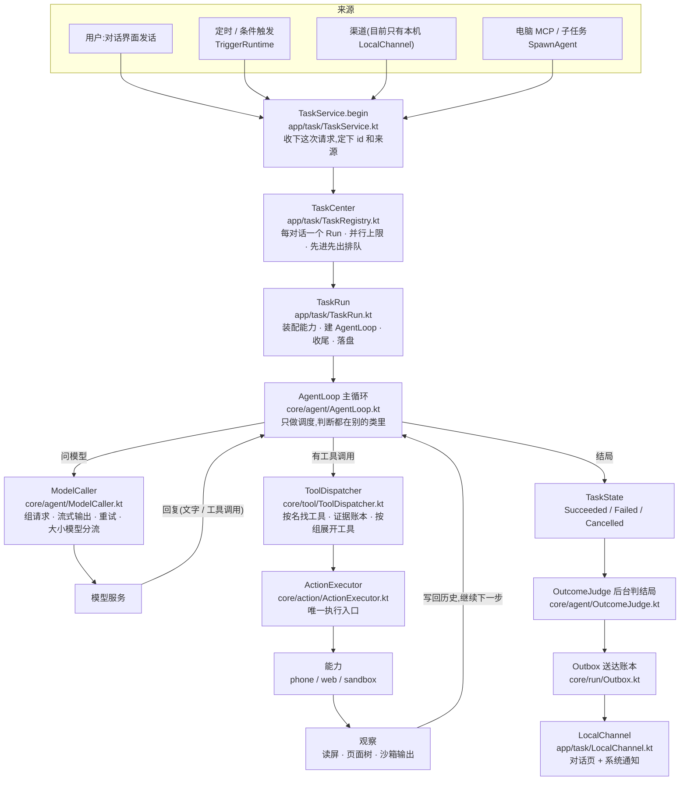

要点:

- **一切改变外部世界的动作都从 `ActionExecutor` 出去**(`core/action/ActionExecutor.kt`)。`ToolDispatcher.execute` 要一个 `ActionPass`,它的构造函数是 `internal`,只有 `ActionExecutor` 能造,编译层面就堵死了绕过的路。
- **`AgentLoop` 自己不判断**。它只把活分给 `ModelCaller`(问模型)、`ActionExecutor`(干活)、`TurnPolicy`/`StopRules`/`StuckAdvice`(提醒与收尾)。新增一条规则通常不是改主循环,而是改那一个类。
- **四条入口走同一套主循环**。对话界面、定时触发、MCP、子任务都建同一个 `AgentLoop`,只是来源(`RunProvenance.origin`)不同,拿到的工具不同、收尾走的通道不同。结果都回到原来那个对话里。

---

## 2. 一次运行的生命周期

### 2.1 从界面到 Run

界面上的一句话到"一个 Run 起来了",中间经过这些函数(`app/…` 指 `app/src/main/java/com/wangzan101/mika/`):

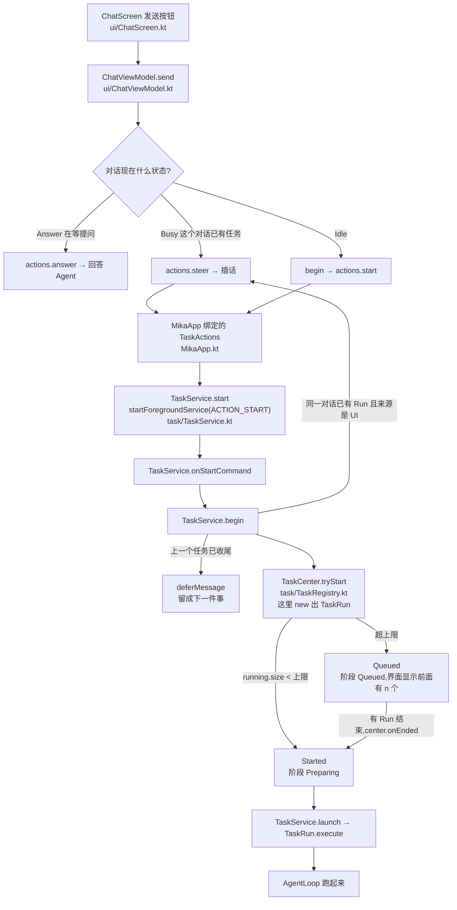

别的入口走同一条链:悬浮胶囊(`capsule/CapsuleController.kt`)、电脑 MCP(`task/McpTaskHub.kt` → `ACTION_START_MCP`)、定时触发(`task/TriggerRuntime.kt` → `ACTION_START_TRIGGER`)、深链群组任务(`ui/MainActivity.kt`)。

### 2.2 阶段

`RunPhase`(`core/run/RunContracts.kt`)是运行在界面上的阶段;`TaskState`(`core/agent/TaskState.kt`)是主循环内部的状态。

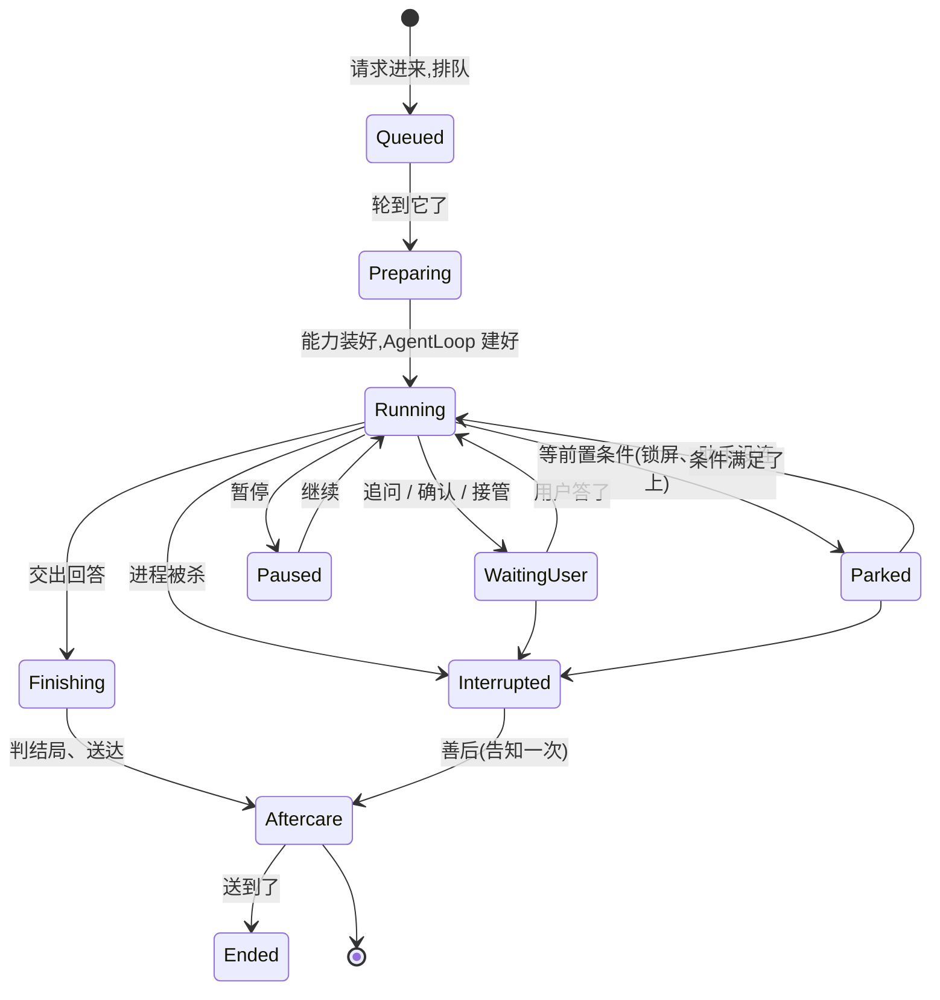

并行规则(`TaskCenter`,在 `task/TaskRegistry.kt`):

- **每个对话同时只有一个 Run**。同一个对话里任务进行中用户又发消息,不另开任务,而是作为**插话**交给正在跑的 Run(`TaskService.begin` → `RunInbox`)。只有定时任务和 MCP 允许在同一个对话里排队。
- **不同对话可以并行**,上限由 `ParallelCapability.detect` 决定:并行开关关着就是 1;否则 Android 13 及以下、低内存设备、第二块屏建失败过,都是 1,其余按用户设的上限夹到 1–3。
- 超上限的进先进先出队列,有 Run 结束时(`center.onEnded`)依次补上,跳过对话里已有 Run 的。
- **并行开关关着(默认)时**,任务进行中不能切换对话;界面发起的另一个对话的任务不进队列、直接忽略。
- **共享资源由 `ResourceScheduler` 统一调度**:两个任务不会同时操作同一个 App;剪贴板、网页标签预算、接管队列也走它。

### 2.3 三本账

| 账 | 写在哪 | 干什么用 |
|---|---|---|
| **运行记录** | `files/runs/<时间>-<编号>/{run.json, events.jsonl, screens/NNNN.jpg}`(`app/record/RunStore.kt`),只留最近 30 次 | 详细过程,给界面看、给评测看、给学习提取用。`RunHandle` 用独立写线程,事件先入队不阻塞主循环。 |
| **阶段账本** | `files/runs-v3.json`(`app/task/FileRunStateStore.kt`,原子替换写) | 这个 Run 现在到哪一步了。进程被杀后靠它判断"哪个运行中断了"。 |
| **送达账本** | `files/outbox-v3.json`(`core/run/Outbox.kt` + `app/task/FileOutboxStore.kt`) | 这条消息送出去了没有。结果的编号是 `result:<运行编号>`。**先记账再发送**,状态不明记 `Uncertain`,不自动重发。 |

---

## 3. 主循环:一步是怎么走的

入口:`AgentLoop.runInternal` → `runLoop` → `loop`(`core/agent/AgentLoop.kt`)。循环体在 `for (step in 1..maxSteps)`,正常任务 `maxSteps = Int.MAX_VALUE`(不设上限),步数上限只用于评测和子任务。

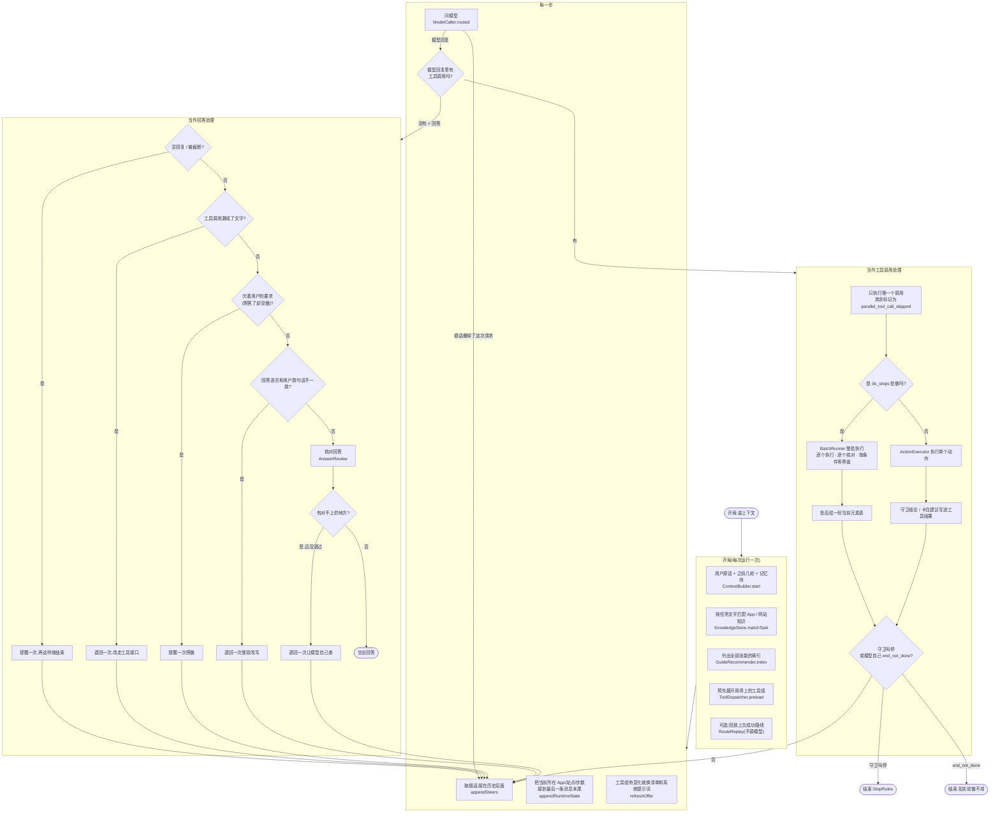

几个容易踩的点:

- **没有"完成"工具**。模型不带工具调用的回复就是给用户的最终回答;带工具调用时附带的文字只是过程说明,显示在界面上。
- **每轮只执行第一个工具调用**,其余的按"并行调用已跳过"回给模型。
- **回复里带工具调用、但要求用户做**(`ask_user` / `request_confirmation` / `hand_to_user`)时,模型这一轮的回复先记进运行记录,再等用户。
- **每一步开头才取插话**。模型已经回了但还没交出时又来了插话,`keepFinished` 会把已经显示的那段字留下,接着继续干。

---

## 4. 开工前:能力怎么装配

`TaskRun.execute`(`app/task/TaskRun.kt`)在建 `AgentLoop` 之前把这一次运行要用的东西都备齐。**大部分是懒的**:不碰手机的任务不会去接手机。

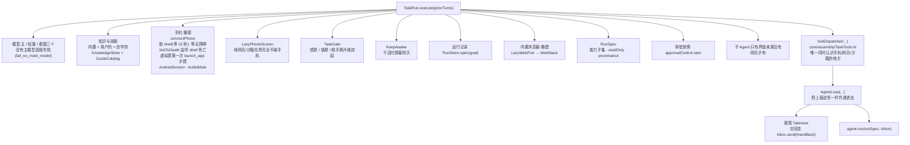

要点:

- **装配层是唯一同时认识三种能力的地方**(`core/assembly/TaskTools.kt`)。核心不认识具体能力,能力之间也互不引用,`PackageDependencyTest` 守着这条线。
- **条件检查的 Run 只给 web + sandbox 两种能力**,并且 `readOnly = true`;网页导航作为"取得读取对象"的准备动作算例外。
- **手机是懒接的**:纯网页或沙箱的任务,`LazyPhoneScreen` 根本不建手机那套,也就不会去等 shell、不会占虚拟屏。

---

## 5. 工具调用:唯一执行入口

模型给出一个工具调用,先落到 `ToolDispatcher.dispatch`(`core/tool/ToolDispatcher.kt`),再进 `ActionExecutor`(`core/action/ActionExecutor.kt`)。**顺序是固定的,改不了**。

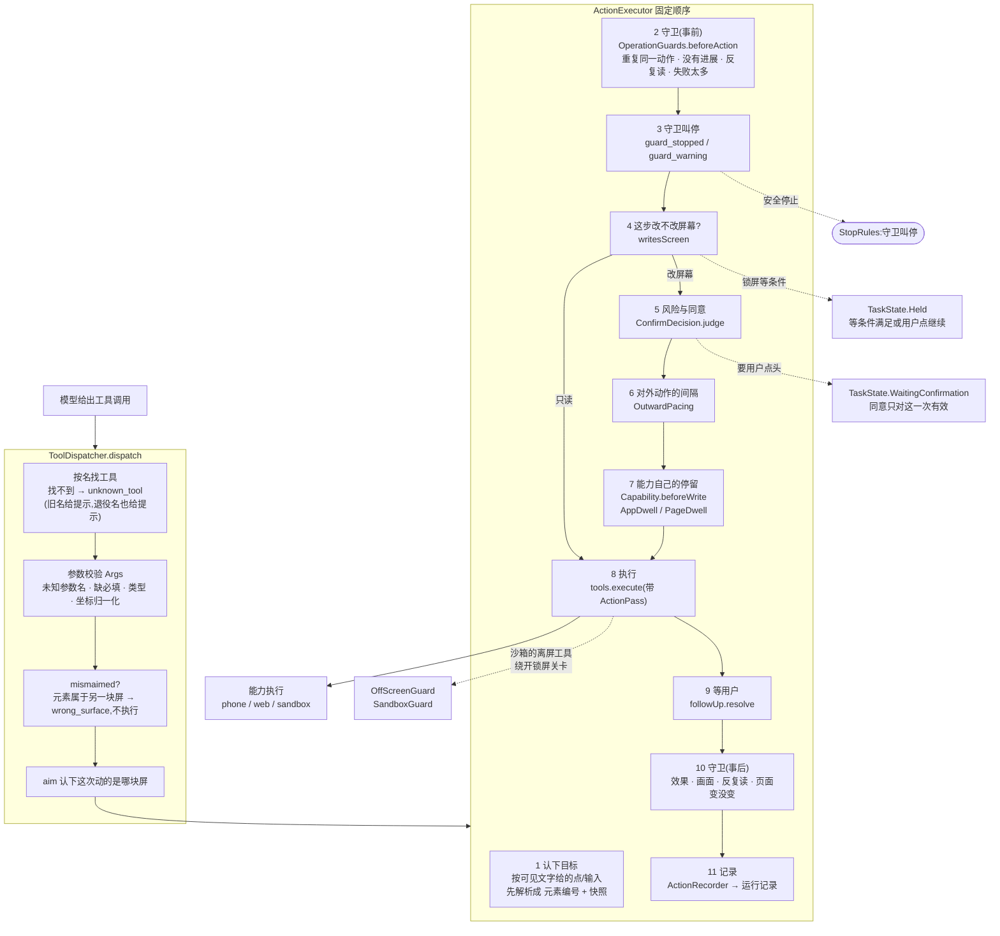

### 5.1 同意是怎么来的

`ConfirmDecision.judge`(`core/action/ConfirmDecision.kt`)按顺序判:

1. **自主模式直接放行**,付款也不问(`autonomous` 早退排在最前面)。
2. **作用在 Mika 自己身上** → 拒(`own_app`)。
3. **这一步要不要检查?** 大部分读和移动动作根本不需要查。
4. **不可逆判定**(`IrreversibleDetector`):点到的、输入到的元素像不像付款、下单、发送、提交、删除。
5. **风险评级**(`RiskJudge`):`Read` / `Change` / `External` / `Irreversible`;屏上有带币种的应付金额时,算付款。
6. **审批策略**(`ApprovalPolicy`):**只有付款才问**。发送、发帖、提交、删除、联系别人、改安全设置、往密码框里打字,一律直接做。
7. **同意是一次性的**:给了也只能用于这一次、这个 App、屏幕上还得看得见那行字;对不上就作废(`confirmation_mismatch`)。

无人在场(定时、渠道、MCP、子任务)问不到人,一律拒绝(`approval_unavailable`)。

### 5.2 工具怎么给、怎么展开

- **工具按声明办事,不写死工具名**:每个工具声明自己的动词、风险(`Read`/`Write`/`External`)、所属能力、能不能进一次多步、能不能进经验路线。
- **两层,用到才展开**(`core/tool/ToolGroups.kt`):通用工具(问用户、等待、没办成就结束、知识与技能、记忆、定时、子任务)一直在;手机、网页、沙箱各是一组,开局只给一个入口工具(`phone_launch_app` / `web_navigate` / `run_command`),调用它之后才展开那一组。**系统提示词和工具清单永远从同一份列表生成**,不会对不上。
- **定义冻结**:一个任务内工具定义不变,端口状态变了也不改已经发过的前缀。

### 5.3 这次运行能拿到哪些工具

装配层(`core/assembly/RunAssembler.kt`)按运行性质裁剪:

| 运行 | 裁掉什么 |
|---|---|
| 无人在场(定时、渠道、MCP) | 追问、确认、接管、建定时、改画像 |
| 子任务 | 上面那些,再加 `spawn_agent`、写记忆;能力只剩 web + sandbox |
| 只读(条件检查) | 只留 `Risk.Read` 的工具,外加网页打开地址 |

---

## 6. 观察:结果怎么回到模型

动作做完不等于任务做完,模型得**看见**结果。

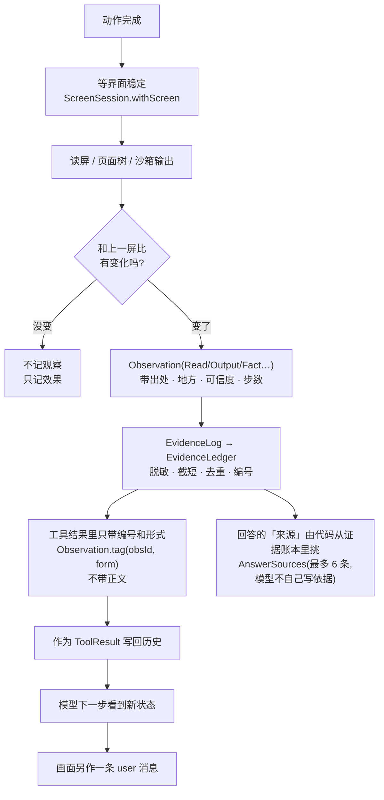

几个设计上的讲究:

- **工具结果里带的是编号不是正文**。这样历史被裁剪、压缩时,模型仍然能指着编号回查证据账本。
- **网页的内容是不可信的**,构建观察时一次性包进 `<untrusted>…</untrusted>`;沙箱输出里回显的命令本身会被剥掉,不当作证据。
- **动作后读屏会等界面安静**,并把和上一屏的差算出来附在结果里。屏幕没变就不记一条观察,免得账本里全是重复的读。
- **动作效果单独报**(`ActionEffect`):点了看不出变化时会标 `no_effect`;控件树读不出那一处时另标 `treeBlind` —— 提示模型"看不出变化不等于没点上",而不是"多半没点上"。
- **回答里的"来源"不是模型写的**:`AnswerSources`(`core/verify/AnswerSources.kt`)从证据账本里挑出支持回答的那几次读取。
- **最后改了界面却没读回结果**,交回答前会提醒模型一次去读(`ReviewFacts.unreadChange`)。
- **核查器拿的是一份新鲜观察**(`Capability.freshLook`),不打扰模型自己手上的元素编号。

---

## 7. 三种要用户参与的交互

都由 `UserExchange`(`core/agent/UserExchange.kt`)管,经 `RunInbox` 回话。

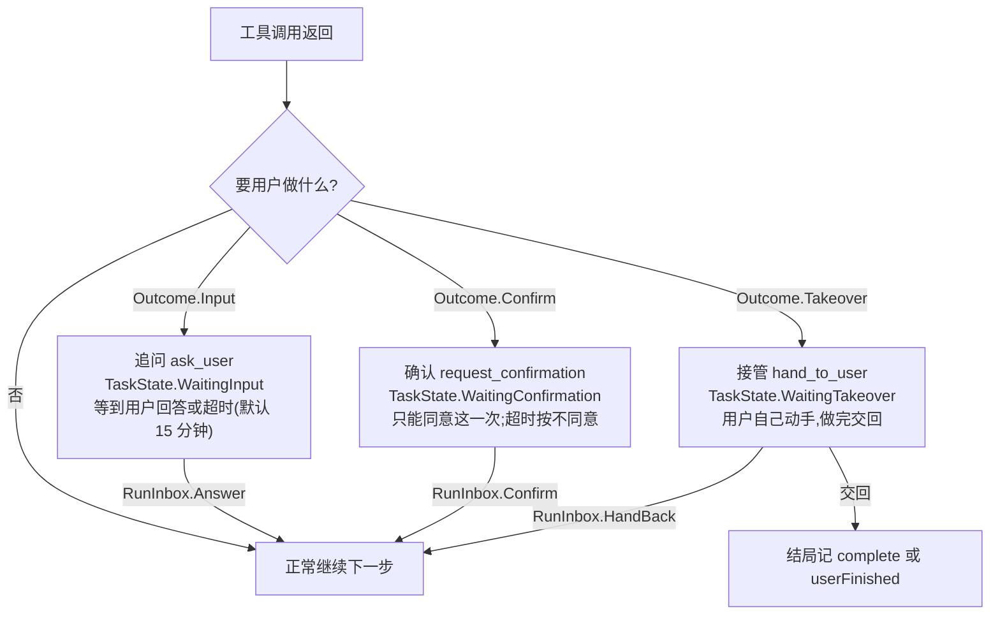

- **三种交互等的时候,任务不算失败**,结局照样往下走。
- **交回接管的结局,是这次工具调用的工具结果**(`hand_to_user` 的工具结果就是用户交回的结果),模型接着看到它。
- **用户刚答了问却什么也没做**:`AgentLoop.owedFollowUp` 会提醒一次"照做或说明为什么不做"。

---

## 8. 插话:运行中用户插进来

这是 Mika 和普通聊天机器人最大的不同:**任务跑着的时候,用户还能说话**,而且说过的话不会丢。

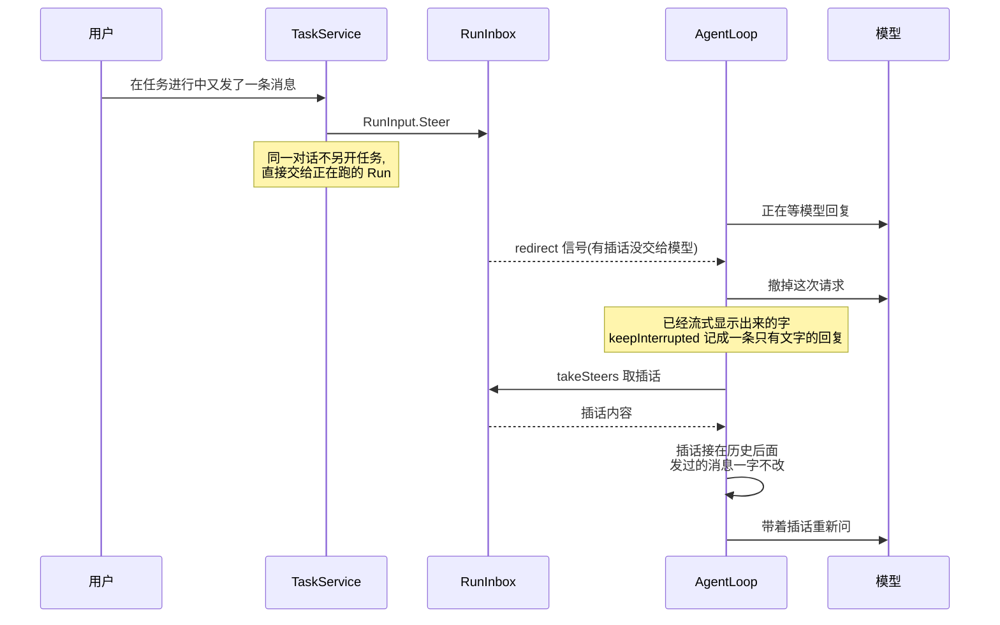

规则:

- **插话是补充,不是覆盖**。已经做过的一概保留,发过的消息一字不改,请求前缀照样只增不变。
- **插话撤掉此刻还在等的模型请求**,但**已经进了执行入口的工具调用照常做完、结果照记**。
- **可中断的等待**:纯等待、只问看图模型的工具、`do_steps` 里按条件等界面的每一段、网页换页前的停留、两次对外动作之间的间隔 —— 这些经 `waitOrSteer` 包着,插话一到就提前结束,工具结果写明"为处理新消息而跳过"。
- **动作做完之后判效果的那一下不截断**,它给的是动作的结果。
- **节奏保护不丢**:被截断的间隔没停够的部分不算停过,下一次换页或对外动作前照样补足。
- **回答交出之前**用 `RunInbox.closeUnlessSteered` 在同一把锁里看和关:还有插话就不收尾,带着它接着做。

---

## 9. 结局:怎么算"做成"

主循环交出结局之后,收尾是在 `TaskService.launch` 的收尾段(`app/task/TaskService.kt`)和进程级作用域里做的:

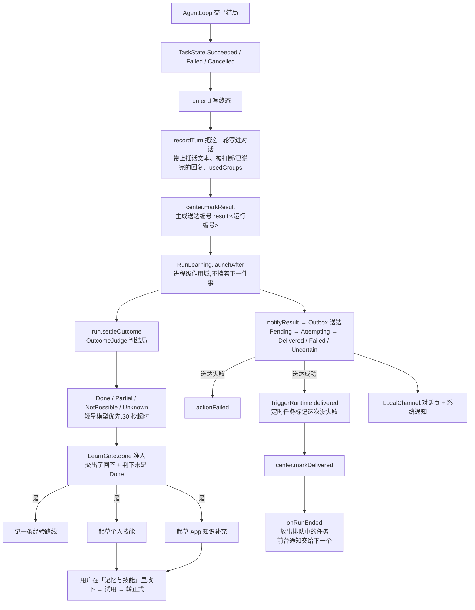

- **没有"完成"工具**。做不成或只做成了一部分时,模型调 `end_not_done`(`core/general/OutcomeTools.kt`),`message` 写清已确认做了什么、卡在哪、现在界面上是什么,`subtype` 是 `blocked` / `login_incomplete` / `captcha_incomplete` / `route_failed` / `device_unavailable` / `interaction_failed` 之一。
- **学习只看判过的结局,不看核查**。核查(`AnswerReview` / `Verifier` / `Grounding`)目前是关着的(`TaskRun` 里 `reviewFinalAnswer = false`),所以回答一律记为"未核实",但技能、知识、路线照常学。
- **送达不重发**:状态不明记 `Uncertain`,不自动重发。
- **用户按了停止**:结局是取消,但照样补一段交代当作这一轮的回答(做过什么、看到了什么、哪些没做完),写好之后改进那一轮,下一轮的上文里写"你中途停止了这次任务,停止前:……"。

---

## 10. 旁路:触发、回放、子任务、记忆

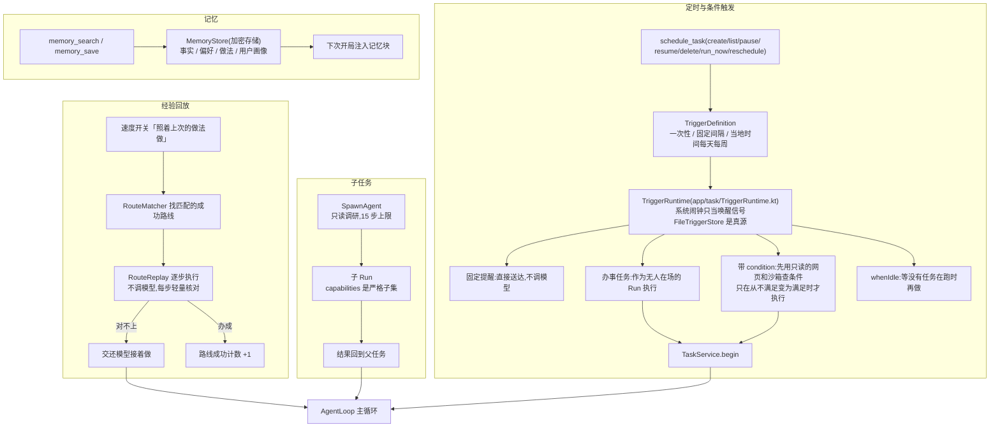

- **回放只记手机上的做法**,点名用网页的任务不回放(网页内容动态、登录态差异会让对位频繁失败)。
- **子任务只读**,步数上限 15,能力是严格子集。
- **触发窗口不会派发两次**:编号 = 触发器 + 到期时间,派发前先写好下次时间和这一次的窗口。

---

## 11. 进程重启后的善后

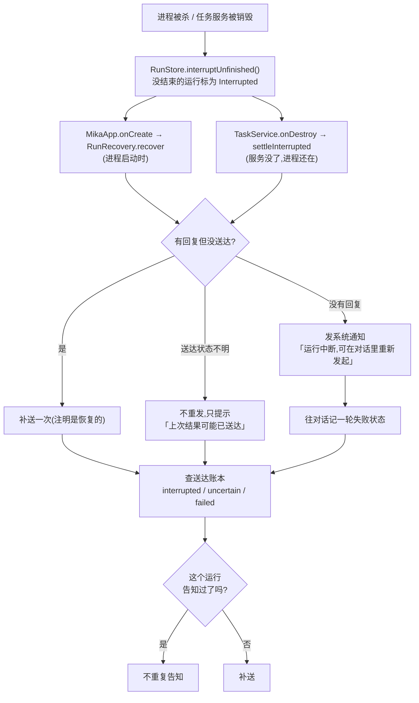

- **"已告知"不另设字段,看送达账本**:有 `interrupted:<运行>`、`uncertain:<送达>`、`failed:<送达>` 任一条提示记录就不再处理。所以重复调用、两个时机撞上都只告知一次。
- **从不从中间续跑**:屏幕状态回不去,只做"中断 → 告知 → 用户重新发起"。

另外还有两件和"运行"无关、但同样要在启动时还原的事(`app/task/TaskRecovery.kt`):

- **被静音的 App 恢复声音**。任务期间静音的 App 把原播放模式存进 SharedPreferences,启动时还原。
- **借用的剪贴板还给用户**。Mika 借走剪贴板时原文加密留底,启动时还原。

这两件都要等内置助手连上(最多等 60 秒)。定时任务在启动时也重新布置(`TriggerRuntime.rearm`)。

---

## 12. 一张图看完整条路

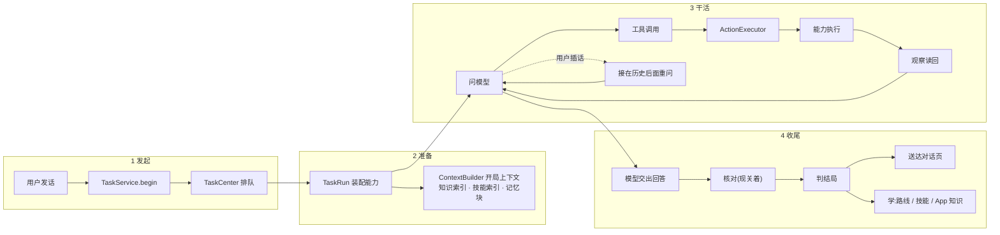

---

## 相关文档

- [`architecture.md`](dev/architecture.md) —— 各层各类的详细说明,这份图只画流程。
- [`roadmap.md`](dev/roadmap.md) —— 还没做的、做了一半的,以及已知问题(例如最终核查目前是关着的)。
- [`knowledge-format.md`](dev/knowledge-format.md) —— 内置知识与技能的文件格式。
